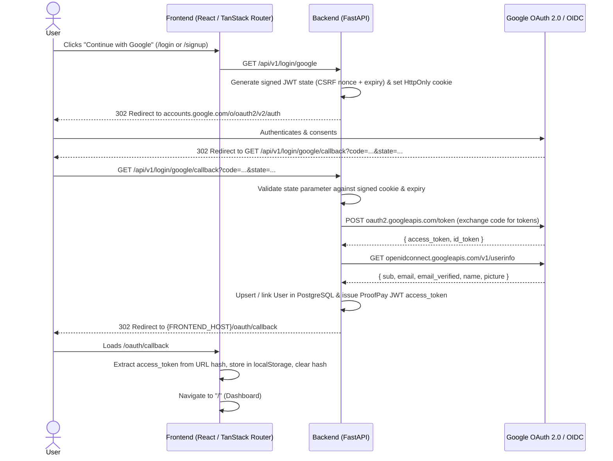

# Specification: Login with Google (Server-Side OAuth 2.0 Flow)

## 1. Overview & Goals

Enable users to sign in and register on **ProofPay** using their Google account via a server-side OAuth 2.0 Authorization Code flow.

### Key Objectives
- **Seamless Sign-In & Sign-Up**: A single "Continue with Google" action on both `/login` and `/signup` pages.
- **Auto-Provisioning & Account Linking**:
  - New users signing in with a verified Google email are automatically provisioned as active `User` records without requiring a password.
  - Existing users (created via email/password) whose email matches a verified Google account are automatically linked (`google_id` attached to their existing `User` record).
- **Security**:
  - Server-side OAuth 2.0 Authorization Code exchange using `httpx`.
  - Stateless signed CSRF `state` token (or HTTP-only signed cookie binding) to prevent login CSRF and open-redirect attacks.
  - Strict verification of Google's `email_verified` claim before linking or creating accounts.
  - Safe handling of passwordless (Google-only) accounts in password login and password update flows.

---

## 2. Architecture & OAuth 2.0 Flow

> [!IMPORTANT]
> Passing the issued `access_token` in the URL fragment (`#access_token=...`) on the redirect to `{FRONTEND_HOST}/oauth/callback` ensures the token is not sent in HTTP `Referer` headers or logged in upstream proxy access logs, while remaining compatible with the existing `localStorage.getItem("access_token")` architecture in [`useAuth.ts`](file:///Users/nayhtet/code/BCHhackathon/proof-pay/frontend/src/hooks/useAuth.ts).

---

## 3. Data Model & Database Changes

### 3.1 `User` Table Updates ([`backend/app/models.py`](file:///Users/nayhtet/code/BCHhackathon/proof-pay/backend/app/models.py))

| Column | Type | Nullable | Constraints / Index | Description |
| :--- | :--- | :--- | :--- | :--- |
| `hashed_password` | `str \| None` | `True` (changed from `False`) | — | Nullable so Google-authenticated users do not need a dummy password. |
| `google_id` | `str \| None` | `True` | `unique=True`, `index=True`, `max_length=255` | Google's unique subject identifier (`sub` claim). |
| `avatar_url` | `str \| None` | `True` | `max_length=512` | Optional profile image URL from Google (`picture` claim). |

### 3.2 API Schema Updates ([`backend/app/models.py`](file:///Users/nayhtet/code/BCHhackathon/proof-pay/backend/app/models.py))
- **`UserPublic`**:
  - Add `has_password: bool = True` (computed or serialized from `bool(user.hashed_password)`) and `google_linked: bool = False` (computed from `bool(user.google_id)`), plus `avatar_url: str | None = None` so the frontend Settings page knows whether the user has a local password set or is a Google-linked account.
- **`SetPassword`** (optional schema or extension of `UpdatePassword`):
  - Allow Google-only users (`hashed_password is None`) to set an initial password in Settings without requiring `current_password`, or display an informational notice in the Password tab with a "Send password setup link" / "Set Password" form.

---

## 4. Configuration & Environment Variables

### 4.1 Backend Settings ([`backend/app/core/config.py`](file:///Users/nayhtet/code/BCHhackathon/proof-pay/backend/app/core/config.py))
Add the following settings to `Settings`:
- `GOOGLE_CLIENT_ID: str | None = None`
- `GOOGLE_CLIENT_SECRET: str | None = None`
- `GOOGLE_REDIRECT_URI: str | None = None`
  - Computed fallback if not explicitly provided: `f"http://localhost:8000{self.API_V1_STR}/login/google/callback"` in development, or configurable via `.env`.
- `google_oauth_enabled` (`@computed_field` property):
  - Returns `bool(self.GOOGLE_CLIENT_ID and self.GOOGLE_CLIENT_SECRET)`.

---

## 5. Backend API Specification

### 5.1 `GET /api/v1/login/google`
- **Purpose**: Initiates the Google OAuth 2.0 login flow.
- **Behavior**:
  1. Verify `settings.google_oauth_enabled`; if `False`, return `503 Service Unavailable` (`detail="Google login is not configured"`).
  2. Generate a short-lived signed JWT `state` token (5-minute expiry, signed with `settings.SECRET_KEY`, `purpose="google_oauth_state"` and a random `nonce`).
  3. Construct the Google OAuth 2.0 authorization URL (`https://accounts.google.com/o/oauth2/v2/auth`) with query parameters:
     - `client_id`: `settings.GOOGLE_CLIENT_ID`
     - `redirect_uri`: `settings.google_redirect_uri`
     - `response_type`: `"code"`
     - `scope`: `"openid email profile"`
     - `state`: `<signed_state_jwt>`
     - `access_type`: `"online"`
     - `prompt`: `"select_account"`
  4. Set an `HttpOnly`, `SameSite=Lax` cookie `oauth_state=<nonce>` (max_age=300) on the `RedirectResponse` and redirect (`302 Found`) the browser to Google.

### 5.2 `GET /api/v1/login/google/callback`
- **Purpose**: Handles the OAuth 2.0 redirect callback from Google.
- **Query Parameters**:
  - `code: str | None = None`
  - `state: str | None = None`
  - `error: str | None = None`
- **Behavior**:
  1. If `error` is present (e.g., `access_denied`) or `code`/`state` is missing, redirect to `{settings.FRONTEND_HOST}/login?error=google_auth_cancelled`.
  2. Verify the `state` JWT signature, expiration, and match its `nonce` claim against the `oauth_state` cookie. If invalid, redirect to `{settings.FRONTEND_HOST}/login?error=invalid_oauth_state`.
  3. Exchange `code` for tokens via `POST https://oauth2.googleapis.com/token` using `httpx.AsyncClient` (or sync `httpx.Client` inside a `def` route per FastAPI conventions).
  4. Fetch user profile via `GET https://openidconnect.googleapis.com/v1/userinfo` using the Google `access_token`.
  5. Validate that `email` is present and `email_verified is True`. If not verified, redirect to `{settings.FRONTEND_HOST}/login?error=unverified_google_email`.
  6. **Account Resolution & Linking** (`crud.authenticate_google`):
     - **Case 1 (Lookup by `google_id`)**: If a `User` exists with `User.google_id == sub`:
       - Use that user (update `avatar_url` or `full_name` if previously unset).
     - **Case 2 (Lookup by `email` — Auto-Link)**: Else if a `User` exists with `User.email == email`:
       - Link account by setting `user.google_id = sub` and updating `avatar_url` (and `full_name` if empty).
     - **Case 3 (New User — Auto-Create)**: Else create a new `User` with:
       - `email=email`
       - `full_name=name`
       - `google_id=sub`
       - `avatar_url=picture`
       - `hashed_password=None`
       - `is_active=True`, `is_superuser=False`
  7. Check `user.is_active`. If inactive, redirect to `{settings.FRONTEND_HOST}/login?error=inactive_user`.
  8. Mint a ProofPay access token using `security.create_access_token(user.id, expires_delta=...)`.
  9. Delete the `oauth_state` cookie and return a `302` `RedirectResponse` to:
     `{settings.FRONTEND_HOST}/oauth/callback#access_token={access_token}&token_type=bearer`

### 5.3 Password Auth Safeguards for Google-Only Users
- **`crud.authenticate` ([`backend/app/crud.py`](file:///Users/nayhtet/code/BCHhackathon/proof-pay/backend/app/crud.py))**:
  - When `db_user.hashed_password is None` (a Google-only user attempts email+password login), run `verify_password(password, DUMMY_HASH)` for constant-time execution and return `None` (preventing a `TypeError` inside `pwdlib`).
- **`PATCH /api/v1/users/me/password` ([`backend/app/api/routes/users.py`](file:///Users/nayhtet/code/BCHhackathon/proof-pay/backend/app/api/routes/users.py))**:
  - If `current_user.hashed_password is None`, return `400 Bad Request` (`detail="Account uses Google sign-in and has no password set. Use password recovery to set a password."`) or support setting an initial password.
- **`POST /api/v1/reset-password/` ([`backend/app/api/routes/login.py`](file:///Users/nayhtet/code/BCHhackathon/proof-pay/backend/app/api/routes/login.py))**:
  - Works out-of-the-box to let a Google-only user set a local password via email recovery if they ever want both login methods.

---

## 6. Frontend Specification

### 6.1 Google Sign-In Button Component
- Create a reusable component `frontend/src/components/Common/GoogleLoginButton.tsx`:
  - Renders a styled shadcn `Button` (`variant="outline"`, `type="button"`, `className="w-full"`) with the official multi-color Google "G" SVG icon and label `"Continue with Google"`.
  - On click, navigates the browser window to `${import.meta.env.VITE_API_URL || ""}/api/v1/login/google`.
- Add the button + an `"Or continue with"` separator to:
  - [`frontend/src/routes/login.tsx`](file:///Users/nayhtet/code/BCHhackathon/proof-pay/frontend/src/routes/login.tsx)
  - [`frontend/src/routes/signup.tsx`](file:///Users/nayhtet/code/BCHhackathon/proof-pay/frontend/src/routes/signup.tsx)
- Display a toast or alert on `/login` if redirected back with `?error=...` query parameter (e.g. `google_auth_cancelled`, `invalid_oauth_state`, `inactive_user`).

### 6.2 OAuth Callback Route (`frontend/src/routes/oauth.callback.tsx`)
- Route path: `/oauth/callback`
- Behavior on mount / `beforeLoad`:
  1. Parse `window.location.hash` (e.g., `#access_token=...`) or `?error=...` search params.
  2. If `access_token` is present:
     - Store `localStorage.setItem("access_token", token)`.
     - Clear the URL hash (`window.history.replaceState`) so the token does not remain in browser history.
     - Invalidate `["currentUser"]` query and redirect to `"/"`.
  3. If missing or invalid:
     - Redirect to `"/login"` with an error message.

---

## 7. Security & Edge Cases

1. **CSRF Protection**: The `state` parameter is both cryptographically signed with `SECRET_KEY` (with a 5-minute `exp`) and bound to the browser session via an `HttpOnly`, `SameSite=Lax` cookie.
2. **Unverified Emails**: Google accounts with `email_verified != True` are rejected to prevent account takeover via unverified email pre-registration.
3. **Timing Attack Prevention**: Attempting password login on an email that only has Google sign-in still runs `verify_password(password, DUMMY_HASH)` so attackers cannot enumerate which accounts are Google-only.
4. **Inactive Users**: Even if a user authenticates with Google, `user.is_active == False` blocks token issuance.
